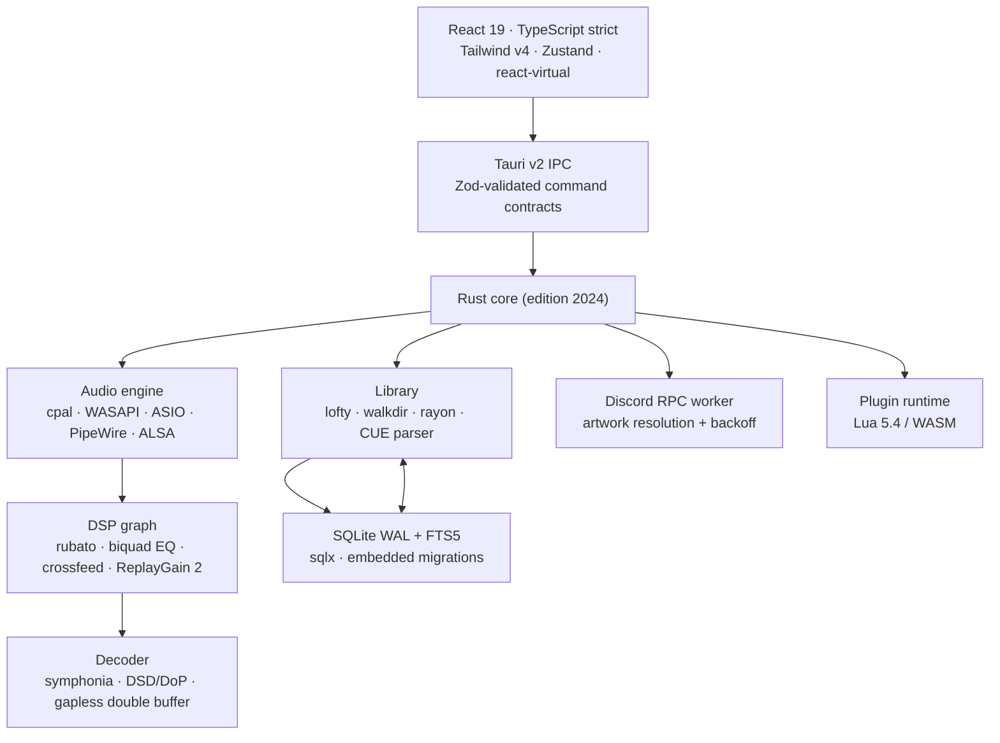

<div align="center">


# Prism

**An audiophile-grade local music player for Windows and Linux.**

Rust audio engine · Tauri v2 desktop shell · React 19 interface · SQLite (WAL + FTS5) catalogue

[](https://github.com/prism-audio/prism/actions/workflows/ci.yml)
[](https://github.com/prism-audio/prism/releases)
[](LICENSE)
[](https://v2.tauri.app)
[](https://www.rust-lang.org)
[](#installation)

**Bit-perfect output · gapless playback · parametric DSP · 500 000-track libraries · 120 FPS interface**

</div>

---

## What Prism is

Prism pairs the cataloguing depth of **foobar2000 / fooyin** with the visual craft and fluidity of
**Apple Music**: a native Rust engine that talks directly to WASAPI Exclusive, ASIO, PipeWire and
ALSA, and an editorial, glass-on-OLED interface that stays at 120 FPS while scrolling a half-million
tracks.

This repository is built in public, phase by phase, with every module implemented to production
standards — no mocks, no `TODO`s, no placeholder logic. The table below is the honest status of the
implementation, not the ambition.

| Phase | Scope                                                                                           | Status          |
| :---- | :---------------------------------------------------------------------------------------------- | :-------------- |
| **1** | Repository, toolchain, SQLite schema + FTS5, Tauri shell, IPC contract, CI/CD, release pipeline | ✅ **Complete** |
| **2** | Audio engine, device backends (WASAPI/ASIO/PipeWire/ALSA), gapless + RAM Play, DSP graph        | ✅ **Complete** |
| **3** | Metadata scanner + incremental indexing, FTS5 search & read models, cover art, Discord RPC      | ✅ **Complete** |
| **4** | React shell, virtualised library, PlayerBar, ambient canvas, modular layout system, lyrics      | 🟡 Next         |
| **5** | Plugin runtime (Lua 5.4 / WebAssembly), scrobbling, lyrics fetchers                             | ⬜ Planned      |
| **6** | Stress, fuzzing, memory and latency audits, 120 FPS profiling                                   | ⬜ Planned      |
| **7** | Repository hardening, documentation, signed public release                                      | ⬜ Planned      |

The current build ships a **real, working foundation**: a WAL-mode SQLite catalogue with 16 STRICT tables,
FTS5 external-content search, cascade triggers, integrity constraints, an embedded migration
ledger, a typed and runtime-validated IPC layer, a non-blocking dual-sink logger, and a glass
diagnostics interface that reads live engine state. No screen displays invented data.

---

## Interface

Prism's v0.1.0 shell is a real, running diagnostics surface: an OLED canvas with a slow ambient
spectrum backdrop, a collapsible navigation rail, and live panels for the SQLite engine
(journal mode, durability, integrity probe, page geometry, migration ledger), runtime identity and
library aggregates. Every value is fetched from the Rust backend over validated IPC — nothing on
screen is sample data.

Reproducible screenshots are generated from the running app with
[`scripts/capture-screenshots.sh`](scripts/capture-screenshots.sh) (Xvfb + D-Bus + ImageMagick) and
published under `docs/media/`. They are captured on developer workstations and CI runners with a
GPU-backed WebView; headless containers without a compositor cannot rasterise WebKitGTK, so no
synthetic or mocked screenshot is shipped.

---

## Engineering highlights

### Audio engine (FASE 2)

- **Native output paths** — WASAPI Exclusive with full mixer bypass, WASAPI Shared fallback, ASIO,
  PipeWire with low-latency client, ALSA direct (hw:) for bit-perfect passthrough; hot-swappable
  output devices without stopping the process.
- **Decoding** — `symphonia` for FLAC, ALAC, WAV, AIFF, OGG Vorbis, MP3, AAC and WavPack; DSD over
  PCM up to DSD512 (`DoP` framing at 176.4/352.8/705.6/1411.2 kHz); 16/24/32-bit integer and float,
  44.1 kHz–768 kHz.
- **Gapless, sample-exact** — a dedicated prefetch thread prepares the next track while the current
  one plays, and the boundary is spliced at the exact sample, never at the file edge.
- **RAM Play** — optional per-track or whole-album preload into physical memory; disk is removed
  from the playback path.
- **CUE sheets** — single-image albums become first-class tracks with sample-accurate offsets,
  including images larger than 1 GiB.
- **DSP graph** — `rubato` sinc resampling, 10–31 band parametric EQ (biquads, per-channel), headphone
  crossfeed, ReplayGain 2 / EBU R128 with clipping protection.

### Catalogue (FASE 3)

- **Mass indexing** — streaming `walkdir` + `rayon` parsing in 512-file chunks, 256-row transactions,
  deterministic SHA-256 row identities, incremental `(mtime, size)` fingerprinting, CUE expansion into
  sample-accurate virtual tracks, a resumable scan ledger and per-file error isolation that never
  aborts a 100 000-file scan.
- **Instant search** — FTS5 with diacritic folding, operator-safe query construction, `bm25` ranking
  with per-column weights, highlight snippets, and quality filters (bit depth, sample rate, format,
  year, genre, lossless-only).
- **Cover art** — SHA-256(artist ⋈ album) cache key, provider chain embedded → folder → iTunes →
  MusicBrainz + Cover Art Archive, 1000 px JPEG normalisation, 90-day success TTL, 24-hour negative
  caching, per-key in-flight collapsing and offline mode.
- **Discord Rich Presence** — full IPC transport over UNIX sockets / named pipes, engine-driven
  presence, asynchronous artwork, 1.5× exponential backoff with jitter and offline fallback.

### Interface (FASE 4)

- React 19 + TypeScript strict + Tailwind v4 + Framer Motion + `@tanstack/react-virtual`.
- Virtualised 500k-row grids with atomic Zustand selectors: the FFT meter and playhead cannot
  re-render the library.
- Dynamic ambient canvas: dominant-colour extraction in Rust (`palette`), composited on the GPU.
- Dockable, resizable panels (foobar2000-style layout editing) over an Apple-Music-grade preset.
- Synced LRC lyrics with karaoke follow, waveform seekbar, 31-band FFT spectroscope.

### Extensibility (FASE 5)

- Embedded **Lua 5.4** (`mlua`, vendored) and **WebAssembly** (`wasmtime`) sandboxes.
- Event API: `on_track_change`, `on_dsp_process`, `on_library_scan`, `on_ui_panel_render`.
- Community DSP processors, visualisers, scrobblers (Last.fm, ListenBrainz) and metadata fetchers.

---

## Architecture



Key deliberate decisions:

| Area        | Decision                                                         | Why                                                                                                      |
| :---------- | :--------------------------------------------------------------- | :------------------------------------------------------------------------------------------------------- |
| Persistence | SQLite in WAL, one writer pool, `synchronous=NORMAL`             | Readers never block scans; a crash can lose at most the last uncheckpointed batch                        |
| Search      | FTS5 `content='tracks'`, unicode61 + remove_diacritics 2         | Zero duplication, "Beyonce" finds "Beyoncé", 500k rows in milliseconds                                   |
| Identity    | Expression unique index over normalised path + CUE offset        | Windows/Linux case folding without a second path column; CUE virtual tracks share one image file legally |
| IPC         | Zod schemas mirror every Rust struct                             | Contract drift becomes a visible error, never `undefined` in the UI                                      |
| Logging     | stderr + non-blocking daily file sink                            | An audio callback can never stall on disk I/O                                                            |
| Security    | CSP allowlist, no remote code, capabilities scoped to one window | Local library stays local; no telemetry                                                                  |

Full rationale: [`docs/ARCHITECTURE.md`](docs/ARCHITECTURE.md) · Performance budgets and
methodology: [`docs/PERFORMANCE.md`](docs/PERFORMANCE.md).

---

## Performance targets

These are the acceptance gates for FASE 6, measured on the reference machine described in
`docs/PERFORMANCE.md`:

| Metric                    | Target                | How it is measured                                 |
| :------------------------ | :-------------------- | :------------------------------------------------- |
| Idle memory (RSS)         | **< 50 MB**           | `ps_mem` / Windows Private Bytes after 10 min idle |
| Idle CPU                  | **< 0.5 %**           | 60 s average, audio paused, library loaded         |
| Cold start to interactive | **< 300 ms**          | `Instant` at process start → first painted frame   |
| Library scroll            | **120 FPS sustained** | Chrome DevTools performance trace, 500k rows       |
| Indexing 100k FLAC        | **< 10 s**            | Warm NVMe, metadata only, batched commits          |
| Interaction latency       | **< 16 ms**           | React Profiler + Event Timing API                  |

Measured in FASE 3, on the 2-vCPU benchmark container: 100 000 files indexed cold in **7.3 s** and
rescanned incrementally in **1.6 s** (`cargo test --release --test scanner_bench -- --ignored`).

---

## Installation

### Users

Download the latest artifacts from **[Releases](https://github.com/prism-audio/prism/releases)**:

| Platform    | Artifact        | Notes                                                           |
| :---------- | :-------------- | :-------------------------------------------------------------- |
| Windows x64 | `.msi` (WiX)    | Per-machine or per-user install, WebView2 bootstrapper included |
| Windows x64 | `.exe` (NSIS)   | Language selector, install-mode choice, uninstaller             |
| Windows x64 | `_portable.exe` | No installer; keep next to your library if desired              |
| Linux x64   | `.AppImage`     | `chmod +x` and run; bundles the audio/UI runtime                |
| Linux x64   | `.deb`          | Debian 13 / Ubuntu 24.04 or newer                               |

Linux baseline: **Ubuntu 24.04 LTS / Debian 13** (PipeWire ≥ 1.0, WebKitGTK 4.1). On older
distributions use the AppImage and ALSA output.

The release includes `SHA256SUMS.txt`; verify with `sha256sum -c SHA256SUMS.txt` before installing.
Builds are currently unsigned; Windows SmartScreen and macOS-style Gatekeeper do not apply, but
your browser may ask for confirmation.

### Developers

**Prerequisites**

- Rust **1.88.0** (`rustup` installs the pinned toolchain automatically from `rust-toolchain.toml`)
- Node.js **≥ 20.19** and pnpm **10.34** (`corepack enable`)
- Linux only:

```bash
sudo apt-get update
sudo apt-get install -y \
  build-essential pkg-config libssl-dev \
  libwebkit2gtk-4.1-dev libgtk-3-dev librsvg2-dev \
  libasound2-dev libpipewire-0.3-dev libxdo-dev \
  libayatana-appindicator3-dev libclang-dev
```

**Run**

```bash
pnpm install
pnpm tauri dev            # Vite on :1420 + native window with HMR

# production build (bundles for the current OS)
pnpm tauri build
```

**Verify**

```bash
pnpm check                # tsc --noEmit + ESLint strictTypeChecked + Prettier
pnpm schema:validate      # executes migrations against SQLite, asserts FTS5 invariants
cargo test --all-targets  # Rust unit + SQLite integration tests
cargo clippy --all-targets -- -D warnings
```

Useful environment variables:

| Variable          | Purpose                                        |
| :---------------- | :--------------------------------------------- |
| `PRISM_LOG`       | `tracing` filter, e.g. `prism=debug,sqlx=warn` |
| `TAURI_DEV_HOST`  | HMR host for remote displays / devices         |
| `TAURI_ENV_DEBUG` | Vite: disable minification and emit sourcemaps |

---

## Repository layout

```text
prism/
├── src/                          React 19 shell (FASE 4 baseline)
│   ├── components/               Shell, diagnostics sections, UI primitives
│   ├── hooks/                    Snapshot loading, async actions
│   ├── lib/                      IPC client, formatting, error normalisation
│   ├── stores/                   Zustand shell preferences
│   ├── styles/globals.css        Tailwind v4 entry + OLED design tokens
│   └── types/ipc.ts              Zod contracts mirroring Rust structs
├── src-tauri/
│   ├── migrations/               Embedded SQL migrations (sqlx)
│   ├── src/
│   │   ├── db/                   Pool, PRAGMAs, migrations, health pragmas
│   │   ├── commands/             Tauri command surface (typed errors)
│   │   ├── state.rs              App paths + shared pool
│   │   ├── logging.rs            Dual-sink, non-blocking, retention
│   │   └── error.rs              Serializable error taxonomy
│   ├── capabilities/             Tauri v2 ACL (one window, minimal grants)
│   ├── icons/                    Generated native icon set
│   ├── tests/database.rs         WAL/FTS5/constraint integration tests
│   ├── tauri.conf.json           Bundler, CSP, Windows/Linux packaging
│   └── Cargo.toml                Crate configuration
├── .github/workflows/            ci.yml + release.yml (matrix, changelog, checksums)
├── scripts/                      Version audit, changelog, schema harness
├── docs/                         Architecture, performance, development notes
└── Cargo.toml                    Rust workspace, release profile (LTO fat, CU 1)
```

---

## Database

The schema is versioned, embedded in the binary and applied transactionally at boot
(`src-tauri/migrations/0001_initial_schema.sql`):

- **16 STRICT tables** — `tracks`, `albums`, `artists`, `cue_sheets`, `playlists`, `playlist_items`,
  `smart_playlists`, `lyrics_cache`, `cover_cache`, `play_history`, `settings`, `library_roots`,
  `scan_runs`, `scan_errors`, `eq_presets`, `layouts` and the FTS5 shadow tables.
- **FTS5 external-content index** with insert/update/delete triggers and rename cascades, verified by
  `INSERT INTO tracks_fts(tracks_fts) VALUES('integrity-check')` in CI.
- **Five read models** (`v_track_details`, `v_album_summary`, `v_artist_summary`,
  `v_playlist_summary`, `v_library_stats`) so the UI never assembles joins itself.
- **CUE-aware identity**: virtual tracks share the image path and are disambiguated by sample offset.
- Timestamps are ISO-8601 UTC strings with millisecond precision; all JSON columns are validated by
  SQLite's `json_valid` constraint.

Run `pnpm schema:validate` after any migration change — it applies every file to a real SQLite
database and asserts triggers, cascades, constraints and views still behave.

---

## CI/CD

- **`ci.yml`** — frontend contract (typecheck, ESLint, Prettier, production build), SQLite schema
  harness, and Rust format/clippy/tests on **Linux and Windows**.
- **`release.yml`** — triggered by `v*` tags:
  1. quality gate on Ubuntu 24.04;
  2. native bundles on `windows-latest` and `ubuntu-24.04` (MSI + NSIS + portable EXE; AppImage + DEB);
  3. structured changelog generated from Conventional Commits;
  4. GitHub Release with all artifacts and `SHA256SUMS.txt`.

Cut a release:

```bash
node scripts/check-version.mjs          # all manifests agree
git tag -a v0.1.0 -m "Release v0.1.0"
git push origin v0.1.0
```

Signing (Authenticode / minisign) is wired to fail closed in later phases once certificates exist;
unsigned local builds are expected.

---

## Security & privacy

- No analytics, no telemetry, no account.
- The WebView runs under a strict CSP; network access is restricted to the artwork/metadata hosts the
  engine uses (iTunes, MusicBrainz, Cover Art Archive, LRCLIB).
- Tauri capabilities are scoped to the single `main` window; filesystem and audio work happens in
  Rust, never in the WebView.
- Report vulnerabilities privately — see [`SECURITY.md`](SECURITY.md).

## Licence & dependency policy

MIT © 2026 Prism Contributors. Every Rust and npm dependency is reviewed for licence compatibility
(MIT/BSD/Apache-2.0); GPL code is not linked. `cargo deny` and a licence audit run in the release
checklist.

## Contributing

Read [`CONTRIBUTING.md`](CONTRIBUTING.md). Performance or DSP changes require measurements; UI
changes require a 120 FPS trace and a keyboard-only walkthrough.
