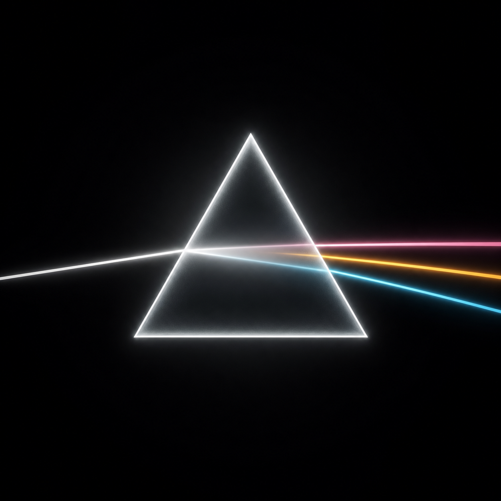
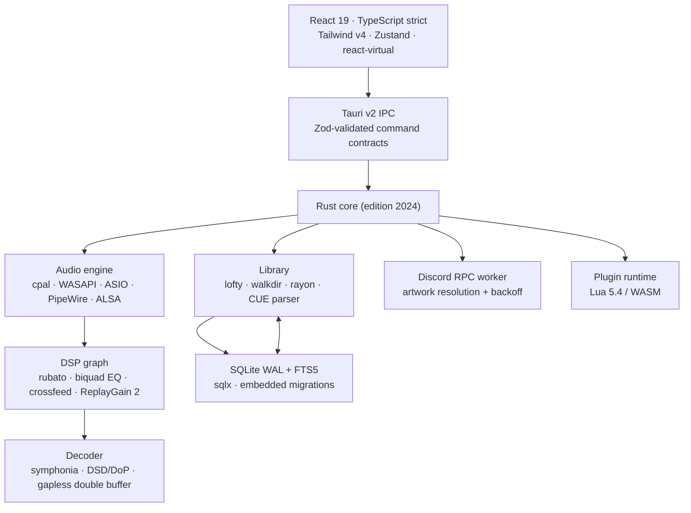

<div align="center">



# Prism

**An audiophile-grade local music player for Windows and Linux.**

Rust audio engine · Tauri v2 desktop shell · React 19 interface · SQLite (WAL + FTS5) catalogue

[](https://github.com/prism-audio/prism/actions/workflows/ci.yml)
[](https://github.com/prism-audio/prism/releases)
[](LICENSE)
[](https://v2.tauri.app)
[](https://www.rust-lang.org)
[](#installation)

**Bit-perfect output · gapless playback · parametric DSP · 500 000-track libraries · 120 FPS interface**

</div>

---

## What Prism is

Prism pairs the cataloguing depth of **foobar2000 / fooyin** with the visual craft and fluidity of
**Apple Music**: a native Rust engine that talks directly to WASAPI Exclusive, ASIO, PipeWire and
ALSA, and an editorial, glass-on-OLED interface that stays at 120 FPS while scrolling a half-million
tracks.

This repository is built in public, phase by phase, with every module implemented to production
standards — no mocks, no `TODO`s, no placeholder logic. The table below is the honest status of the
implementation, not the ambition.

| Phase | Scope                                                                                           | Status       |
| :---- | :---------------------------------------------------------------------------------------------- | :----------- |
| **1** | Repository, toolchain, SQLite schema + FTS5, Tauri shell, IPC contract, CI/CD, release pipeline | **Complete** |
| **2** | Audio engine, device backends (WASAPI/ASIO/PipeWire/ALSA), gapless + RAM Play, DSP graph        | **Complete** |
| **3** | Metadata scanner + incremental indexing, FTS5 search & read models, cover art, Discord RPC      | **Complete** |
| **4** | React shell, PlayerBar, artwork palette engine, ambient canvas, IPC hooks and stores            | **Complete** |
| **5** | Virtualised library views, FFT visualiser, synced lyrics, modular layouts, plugin runtime       | **Complete** |
| **6** | Stress, fuzzing, memory and latency audits, 120 FPS profiling                                   | **Complete** |
| **7** | Repository hardening, licence audit, professional documentation, validated release pipeline     | **Complete** |

The current build ships a **working desktop player**: a native Rust engine that talks to WASAPI
Exclusive, ASIO, PipeWire and ALSA; an incremental catalogue over WAL-mode SQLite with FTS5; and a
React shell whose player bar, transport, device selector and ambient palette all read live engine
state. No screen displays invented data, and every route is implemented — the browser-only build
says so instead of faking an interface.

---

## Interface

Prism's v0.1.0 shell is a real, running diagnostics surface: an OLED canvas with a slow ambient
spectrum backdrop, a collapsible navigation rail, and live panels for the SQLite engine
(journal mode, durability, integrity probe, page geometry, migration ledger), runtime identity and
library aggregates. Every value is fetched from the Rust backend over validated IPC — nothing on
screen is sample data.

Reproducible screenshots are generated from the running app with
[`scripts/capture-screenshots.sh`](scripts/capture-screenshots.sh) (Xvfb + D-Bus + ImageMagick) and
published under `docs/media/`. They are captured on developer workstations and CI runners with a
GPU-backed WebView; headless containers without a compositor cannot rasterise WebKitGTK, so no
synthetic or mocked screenshot is shipped.

---

## Engineering highlights

### Audio engine (FASE 2)

- **Native output paths** — WASAPI Exclusive with full mixer bypass, WASAPI Shared fallback, ASIO,
  PipeWire with low-latency client, ALSA direct (hw:) for bit-perfect passthrough; hot-swappable
  output devices without stopping the process.
- **Decoding** — `symphonia` for FLAC, ALAC, WAV, AIFF, OGG Vorbis, MP3, AAC and WavPack; DSD over
  PCM up to DSD512 (`DoP` framing at 176.4/352.8/705.6/1411.2 kHz); 16/24/32-bit integer and float,
  44.1 kHz–768 kHz.
- **Gapless, sample-exact** — a dedicated prefetch thread prepares the next track while the current
  one plays, and the boundary is spliced at the exact sample, never at the file edge.
- **RAM Play** — optional per-track or whole-album preload into physical memory; disk is removed
  from the playback path.
- **CUE sheets** — single-image albums become first-class tracks with sample-accurate offsets,
  including images larger than 1 GiB.
- **DSP graph** — `rubato` sinc resampling, 10–31 band parametric EQ (biquads, per-channel), headphone
  crossfeed, ReplayGain 2 / EBU R128 with clipping protection.

### Catalogue (FASE 3)

- **Mass indexing** — streaming `walkdir` + `rayon` parsing in 512-file chunks, 256-row transactions,
  deterministic SHA-256 row identities, incremental `(mtime, size)` fingerprinting, CUE expansion into
  sample-accurate virtual tracks, a resumable scan ledger and per-file error isolation that never
  aborts a 100 000-file scan.
- **Instant search** — FTS5 with diacritic folding, operator-safe query construction, `bm25` ranking
  with per-column weights, highlight snippets, and quality filters (bit depth, sample rate, format,
  year, genre, lossless-only).
- **Cover art** — SHA-256(artist ⋈ album) cache key, provider chain embedded → folder → iTunes →
  MusicBrainz + Cover Art Archive, 1000 px JPEG normalisation, 90-day success TTL, 24-hour negative
  caching, per-key in-flight collapsing and offline mode.
- **Discord Rich Presence** — full IPC transport over UNIX sockets / named pipes, engine-driven
  presence, asynchronous artwork, 1.5× exponential backoff with jitter and offline fallback.

### Interface (FASE 4)

- **Player bar** with a real Hi-Res / Bit-perfect / Processed badge: the claim is only made when the
  engine reports an exclusive endpoint, an exact format match, unity gain and no DSP stage.
- **Output selector** listing every reachable endpoint with its driver stack, sample-rate range,
  exclusive capability and a 64–2048-frame buffer choice; the trigger shows the device that is
  _actually_ open, not the one that was requested.
- **Artwork palette engine** in Rust: deterministic median cut, WCAG-checked accents (≥ 4.5:1),
  hue-derived fallback for greyscale sleeves, 512-entry cache — applied as six CSS custom
  properties, so re-tinting the window costs one style write.
- **Ambient canvas** animated on the compositor only (transform/opacity), scaled by the artwork's
  mean luminance, with an Off/Subtle/Full setting and `prefers-reduced-motion` support.
- **State split by update frequency**: the 8 Hz playhead lives in its own store slice and its own
  event channel, so scrolling a five-hundred-thousand-row library cannot be disturbed by the clock.
- Framer Motion restricted to page cross-fades, the player-bar entrance and the segmented indicator.

### Quality engineering (FASE 6)

- **Device and decoder stress** — seven tests drive a loopback endpoint injected through the same
  seam the production build uses: five hot swaps without losing the playhead or the queue, a DAC that
  disappears and is rebuilt, a corrupt file skipped mid-album (with the file named in the UI), a
  queue of nothing but dead files that stops instead of hanging, and a **1.5 GB sparse CUE image**
  expanded into three sample-accurate tracks without reading it.
- **120 FPS, measured** — a harness page mounts the production track list over **500 000 synthetic
  rows** and reports main-thread time per painted frame, not frame rate: **2.8–3.4 ms of the 8.33 ms**
  a 120 Hz panel allows, 0 dropped frames at 60 Hz, 262–305 fps unpinned, 39–40 rows / 755–775 DOM
  nodes, 14.5 MB of JS heap, **CLS exactly 0** with zero shift entries, zero long tasks. `pnpm perf`
  runs it and fails on regression.
- **The optimisations it found** — hoisting the virtualiser's option callbacks (its measurement cache
  was being rebuilt over 500 000 rows on every frame: 18.9 ms → 3.0 ms per frame), bootstrapping the
  first page of the paged list (it never loaded), and moving a status label from text to a dot after
  it registered a 0.0000037 layout shift — a label whose text changes is a shift source.
- **Memory and UB** — `valgrind --tool=memcheck` reports **0 errors** over the stress suite and over
  105 audio unit tests; Miri covers the pure-logic modules in CI.
- **CPU flamegraphs** — `examples/profile_hot_path.rs` profiles the real decode → DSP path with
  `pprof`: **656× real time** bit-perfect, **25× real time** when resampling 44.1 → 48 kHz, with the
  graphs committed under `docs/media/`.
- **Discord RPC offline fallback** — a reconnect schedule as a value (`BackoffPolicy`), six tests
  against a real UNIX socket, a track queued while Discord is closed published the instant it comes
  up, and the handshake bug that turned a rejected client id into an infinite reconnect loop fixed.

### Library and listening interface (FASE 5)

- **500 000 rows, 52 pixels each** — `@tanstack/react-virtual` renders 30–60 rows whatever the library
  holds, and a windowed data layer (`useTrackWindow`) fetches the 500-row pages the viewport needs,
  keeping twelve of them in a bounded, farthest-first-evicted cache. Loading rows are skeletons at the
  exact row height, so a page arriving never moves the list.
- **31-band spectrum analyser** — the FFT runs in Rust on the audio supervisor's producer thread, on
  the block that was just decoded; the webview receives 31 normalised floats at 60 Hz and paints them
  on a canvas with `requestAnimationFrame` interpolation. The tap is reference-counted: no visualiser
  mounted, no cost on the audio thread.
- **Synced lyrics** — embedded `USLT` → sidecar `.lrc` (case-insensitive) → empty, with a parser that
  accepts 1–3 fraction digits, `mm:ss:ff`, multiple timestamps per line, metadata tags, BOM, CRLF,
  unsorted input and `[offset:]` in both signs. The karaoke cursor is a binary search over the
  timestamps; scrolling by hand suspends auto-follow for four seconds instead of fighting the user.
- **Modular Now Playing deck** — artwork, lyrics, spectrum, signal path and queue are independent
  modules with three presets (Editorial, Listening, Analysis), per-module visibility and ordering,
  persisted layout, and the guarantee that one module always remains.

### Extensibility (FASE 5)

- **Sandboxed plugin runtimes**, both opt-in at compile time: Lua 5.4 (`mlua`, vendored, no system
  Lua) and WebAssembly (`wasmtime`, Cranelift, no WASI). The default binary compiles neither and says
  so in Settings instead of failing at load time.
- **Capability-gated host API** — `log`, `notify`, `player:read`, `player:control`, declared in the
  manifest and enforced on every call. Lua plugins run with `io`, `os`, `package`, `debug` and
  `load`/`loadfile`/`dofile` removed, a 16 MiB memory ceiling and a 20 M-instruction budget;
  WebAssembly modules are limited to 64 MiB and 200 M fuel per call.
- **Strict manifests** — `plugin.toml` validated to the character: reverse-DNS ids, semver, API
  revision, relative entry paths that cannot escape the plugin directory, and setting defaults that
  must satisfy their own schema.
- **Configuration UI** — enable/disable, typed setting controls (string, number, integer, boolean,
  select) rendered from the manifest, declared capabilities shown as chips, load errors surfaced
  verbatim, and a live `plugin://message` activity stream.
- A plugin that throws is **disabled for the session** with its error recorded; playback never depends
  on one.
- A complete example ships in [`examples/plugins/volume-guard`](examples/plugins/volume-guard) — a
  manifest, a Lua plugin and its README — and the test suite loads it, so the documented API cannot
  drift away from the working one.

---

## Architecture



Key deliberate decisions:

| Area        | Decision                                                         | Why                                                                                                      |
| :---------- | :--------------------------------------------------------------- | :------------------------------------------------------------------------------------------------------- |
| Persistence | SQLite in WAL, one writer pool, `synchronous=NORMAL`             | Readers never block scans; a crash can lose at most the last uncheckpointed batch                        |
| Search      | FTS5 `content='tracks'`, unicode61 + remove_diacritics 2         | Zero duplication, "Beyonce" finds "Beyoncé", 500k rows in milliseconds                                   |
| Identity    | Expression unique index over normalised path + CUE offset        | Windows/Linux case folding without a second path column; CUE virtual tracks share one image file legally |
| IPC         | Zod schemas mirror every Rust struct                             | Contract drift becomes a visible error, never `undefined` in the UI                                      |
| Logging     | stderr + non-blocking daily file sink                            | An audio callback can never stall on disk I/O                                                            |
| Security    | CSP allowlist, no remote code, capabilities scoped to one window | Local library stays local; no telemetry                                                                  |

Full rationale: [`docs/ARCHITECTURE.md`](docs/ARCHITECTURE.md) · Performance budgets and
methodology: [`docs/PERFORMANCE.md`](docs/PERFORMANCE.md).

---

## Performance targets

These are the acceptance gates for FASE 6, measured on the reference machine described in
`docs/PERFORMANCE.md`:

| Metric                    | Target                | How it is measured                                 |
| :------------------------ | :-------------------- | :------------------------------------------------- |
| Idle memory (RSS)         | **< 50 MB**           | `ps_mem` / Windows Private Bytes after 10 min idle |
| Idle CPU                  | **< 0.5 %**           | 60 s average, audio paused, library loaded         |
| Cold start to interactive | **< 300 ms**          | `Instant` at process start → first painted frame   |
| Library scroll            | **120 FPS sustained** | `pnpm perf`: 500k rows, main-thread ms per frame   |
| Indexing 100k FLAC        | **< 10 s**            | Warm NVMe, metadata only, batched commits          |
| Interaction latency       | **< 16 ms**           | `pnpm perf`: main-thread ms per frame while typing |

Measured in FASE 3, on the 2-vCPU benchmark container: 100 000 files indexed cold in **7.3 s** and
rescanned incrementally in **1.6 s** (`cargo test --release --test scanner_bench -- --ignored`).

Measured in FASE 6, same container, headless Chromium, **500 000 synthetic rows**:

| Probe                               | Result                                                                            |
| :---------------------------------- | :-------------------------------------------------------------------------------- |
| Scroll, 120 px/frame (120 FPS gate) | **2.8–3.4 ms** of main-thread work per frame — 2.5–3.0× inside the 8.33 ms budget |
| Scroll, 60 Hz display               | 60.0 fps, **0 frames over budget**                                                |
| Scroll, unpinned                    | **262–305 fps**, mean frame 3.3–3.8 ms, p95 5.6–7.1 ms                            |
| Typing in the filter                | **0.1–0.3 ms** per frame                                                          |
| DOM for 500 000 tracks              | **39–40 rows / 755–775 nodes** · 14.5 MB JS heap                                  |
| Layout shift                        | **CLS = 0** exactly, zero shift entries                                           |

Rust side, same phase: **656× real time** decoding bit-perfect (0.018 ms per 512-frame block) and
**25× real time** when resampling 44.1 → 48 kHz; **0 valgrind errors** across the device stress suite
and 105 audio unit tests.

---

## Installation

### Users

Download the latest artifacts from **[Releases](https://github.com/prism-audio/prism/releases)**:

| Platform    | Artifact        | Notes                                                           |
| :---------- | :-------------- | :-------------------------------------------------------------- |
| Windows x64 | `.msi` (WiX)    | Per-machine or per-user install, WebView2 bootstrapper included |
| Windows x64 | `.exe` (NSIS)   | Language selector, install-mode choice, uninstaller             |
| Windows x64 | `_portable.exe` | No installer; keep next to your library if desired              |
| Linux x64   | `.AppImage`     | `chmod +x` and run; bundles the audio/UI runtime                |
| Linux x64   | `.deb`          | Debian 13 / Ubuntu 24.04 or newer                               |

Linux baseline: **Ubuntu 24.04 LTS / Debian 13** (PipeWire ≥ 1.0, WebKitGTK 4.1). On older
distributions use the AppImage and ALSA output.

The release includes `SHA256SUMS.txt`; verify with `sha256sum -c SHA256SUMS.txt` before installing.
Builds are currently unsigned; Windows SmartScreen and macOS-style Gatekeeper do not apply, but
your browser may ask for confirmation.

### Developers

**Prerequisites**

- Rust **1.88.0** (`rustup` installs the pinned toolchain automatically from `rust-toolchain.toml`)
- Node.js **≥ 20.19** and pnpm **10.34** (`corepack enable`)
- Linux only:

```bash
sudo apt-get update
sudo apt-get install -y \
  build-essential pkg-config libssl-dev \
  libwebkit2gtk-4.1-dev libgtk-3-dev librsvg2-dev \
  libasound2-dev libpipewire-0.3-dev libxdo-dev \
  libayatana-appindicator3-dev libclang-dev
```

**Run**

```bash
pnpm install
pnpm tauri dev            # Vite on :1420 + native window with HMR

# production build (bundles for the current OS)
pnpm tauri build
```

**Verify**

```bash
pnpm check                # tsc --noEmit + ESLint strictTypeChecked + Prettier
pnpm schema:validate      # executes migrations against SQLite, asserts FTS5 invariants
cargo test --all-targets  # Rust unit + SQLite integration tests
cargo clippy --all-targets -- -D warnings
```

Useful environment variables:

| Variable          | Purpose                                        |
| :---------------- | :--------------------------------------------- |
| `PRISM_LOG`       | `tracing` filter, e.g. `prism=debug,sqlx=warn` |
| `TAURI_DEV_HOST`  | HMR host for remote displays / devices         |
| `TAURI_ENV_DEBUG` | Vite: disable minification and emit sourcemaps |

---

## Repository layout

```text
prism/
├── src/                          React 19 shell
│   ├── components/               Shell, library, now-playing, UI primitives
│   ├── hooks/                    Paged track window, async actions, snapshots
│   ├── lib/                      IPC client, formatting, error normalisation
│   ├── perf/                     120 FPS harness (benchmark + synthetic catalogue)
│   ├── plugins/                  Plugin panel and host bridge
│   ├── stores/                   Zustand slices (playback, library, shell, plugins)
│   ├── styles/globals.css        Tailwind v4 entry + OLED design tokens
│   └── types/ipc.ts              Zod contracts mirroring Rust structs
├── src-tauri/
│   ├── migrations/               Embedded SQL migrations (sqlx)
│   ├── examples/                 profile_hot_path — pprof flamegraphs and throughput
│   ├── src/
│   │   ├── audio/                Engine, decoder, DSP, backends, ring buffer
│   │   ├── metadata/             Tag reader, scanner, CUE expansion
│   │   ├── plugins/              Lua and WASM runtimes, capability bridge
│   │   ├── discord/              RPC transport and backoff policy
│   │   ├── db/                   Pool, PRAGMAs, migrations, read models
│   │   └── commands/             Tauri command surface (typed errors)
│   ├── tests/                    database, library, engine, stress, discord, palette
│   ├── capabilities/             Tauri v2 ACL (one window, minimal grants)
│   └── tauri.conf.json           Bundler, CSP, Windows/Linux packaging
├── .github/workflows/            ci.yml (5 jobs) + release.yml (quality → bundle → publish)
├── docs/                         ARCHITECTURE, PERFORMANCE, RELEASE, LICENSES, PHASE-1…6
├── scripts/                      Version audit, licence audit, release validator, 120 FPS audit
└── Cargo.toml                    Rust workspace, release profile (LTO fat, CU 1)
```

---

## Database

The schema is versioned, embedded in the binary and applied transactionally at boot
(`src-tauri/migrations/0001_initial_schema.sql`):

- **16 STRICT tables** — `tracks`, `albums`, `artists`, `cue_sheets`, `playlists`, `playlist_items`,
  `smart_playlists`, `lyrics_cache`, `cover_cache`, `play_history`, `settings`, `library_roots`,
  `scan_runs`, `scan_errors`, `eq_presets`, `layouts` and the FTS5 shadow tables.
- **FTS5 external-content index** with insert/update/delete triggers and rename cascades, verified by
  `INSERT INTO tracks_fts(tracks_fts) VALUES('integrity-check')` in CI.
- **Five read models** (`v_track_details`, `v_album_summary`, `v_artist_summary`,
  `v_playlist_summary`, `v_library_stats`) so the UI never assembles joins itself.
- **CUE-aware identity**: virtual tracks share the image path and are disambiguated by sample offset.
- Timestamps are ISO-8601 UTC strings with millisecond precision; all JSON columns are validated by
  SQLite's `json_valid` constraint.

Run `pnpm schema:validate` after any migration change — it applies every file to a real SQLite
database and asserts triggers, cascades, constraints and views still behave.

---

## CI/CD

- **`ci.yml`** — frontend contract (typecheck, ESLint, Prettier, production build), SQLite schema
  harness, Rust format/clippy/tests on **Linux and Windows**, the dependency-licence audit and the
  release-pipeline validator; plus the `qa` (Miri + valgrind) and `performance` (120 FPS budget)
  jobs described in [`docs/PHASE-6.md`](docs/PHASE-6.md).
- **`release.yml`** — triggered by `v*` tags:
  1. quality gate on Ubuntu 24.04: versions, licences, frontend contract, schema, and the static
     validation of this very workflow;
  2. native bundles on `windows-latest` and `ubuntu-24.04` (MSI + NSIS + portable EXE; AppImage + DEB);
  3. release notes from the curated `CHANGELOG.md` section, with the commit list appended;
  4. GitHub Release with all artefacts, `THIRD-PARTY-LICENSES.md` and `SHA256SUMS.txt`.

Cut a release — the whole procedure is in [`docs/RELEASE.md`](docs/RELEASE.md):

```bash
node scripts/check-version.mjs          # every manifest agrees on the version
python3 scripts/validate_release.py     # 30 static checks over release.yml
git tag -a v0.1.0 -m "Release v0.1.0"
git push origin v0.1.0
```

Signing (Authenticode / minisign) is wired to fail closed in later phases once certificates exist;
unsigned local builds are expected.

---

## Security & privacy

- No analytics, no telemetry, no account.
- The WebView runs under a strict CSP; network access is restricted to the artwork/metadata hosts the
  engine uses (iTunes, MusicBrainz, Cover Art Archive, LRCLIB).
- Tauri capabilities are scoped to the single `main` window; filesystem and audio work happens in
  Rust, never in the WebView.
- Report vulnerabilities privately — see [`SECURITY.md`](SECURITY.md).

## Licence & dependency policy

MIT © 2026 Prism Contributors — see [`LICENSE`](LICENSE).

Prism ships **671 third-party packages** (651 Rust crates linked into the binary, 20 npm packages
bundled into the WebView). Every one of them is classified by a generated audit:

```bash
pnpm licenses        # regenerate docs/LICENSES.md from Cargo.lock + pnpm-lock.yaml
pnpm licenses:check  # CI: fail if the inventory or the policy drifts
```

The policy is enforced, not aspirational: GPL, AGPL, SSPL, EPL, CDDL and the Commons Clause are
refused, dual-licensed crates are resolved to their least demanding branch, and only the default
feature set is counted — the `profiling` tooling never enters a release artefact. Today that yields
**652 permissive packages, 19 with a notice obligation, and no copyleft code in the binary**; the
MPL-2.0 decoders and the OFL typeface are documented with their obligations in
[`docs/LICENSES.md`](docs/LICENSES.md), which is also attached to every release.

## Contributing

Read [`CONTRIBUTING.md`](CONTRIBUTING.md). Performance or DSP changes require measurements; UI
changes require a 120 FPS trace and a keyboard-only walkthrough.
