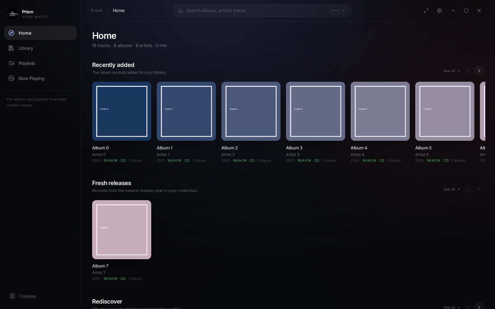
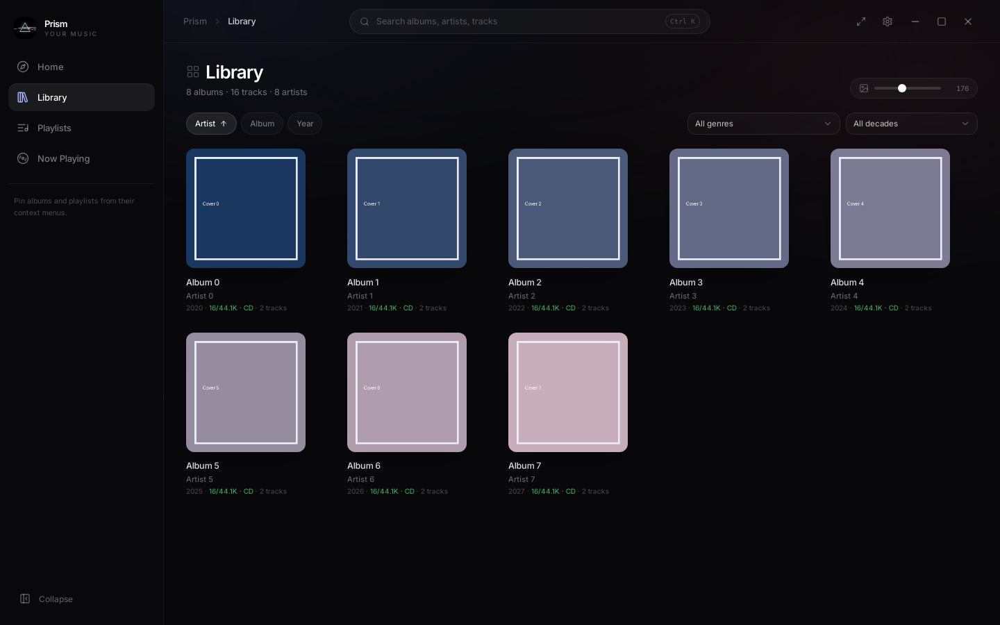
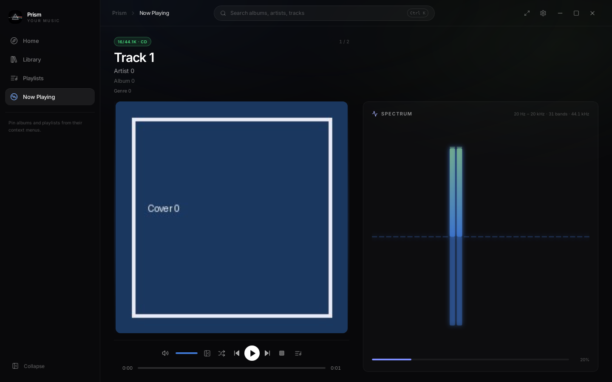
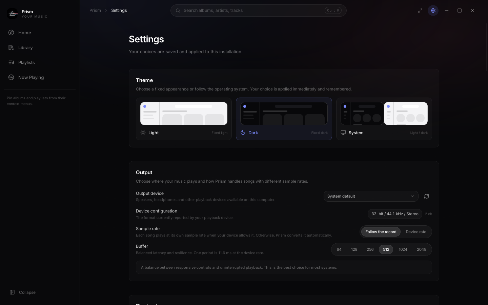

<div align="center">


# Prism

**A local music player for Windows and Linux.**

Prism combines a Rust playback engine, a SQLite catalogue and a Tauri desktop interface. It is
designed for local music libraries, precise format handling and a configurable listening workspace.

</div>

## Features

### Playback

- Gapless playback with prefetching and sample-aware track boundaries.
- A full-page, reorderable queue opened from the Player Bar, with album groups, Play next,
  removal, double-click jumping and queue-aware Skip. Album playback stops at its boundary by
  default; optional continuation follows the originating Library filters and ordering.
- Shuffle with exact prior-order restoration and immediate volume changes while dragging.
- Native output through WASAPI, optional ASIO, PipeWire and ALSA, with a shared-output fallback.
- Source-rate and fixed-rate output policies, with format negotiation and resampling when required.
- FLAC, ALAC, WAV, AIFF, Ogg Vorbis and MP3 decoding, plus DSF/DFF input and DSD over PCM.
- CUE sheets, including individual tracks within a single audio image.
- ReplayGain, parametric EQ, crossfeed, volume ramping and optional in-memory playback.
- Source labels that distinguish CD, Hi-Res and other formats. Output details remain available in
  Settings, and bit-perfect status is shown only when the complete path satisfies its requirements.

### Library

- Incremental scanning with per-file error isolation and cooperative cancellation.
- Album, artist, genre and multi-disc browsing with persistent sorting and transient search,
  genre, decade and year filters, including complete-release-date Year ordering and dynamic facets
  based on available albums. A Clear filters action restores the complete Library.
- Full-text search with diacritic folding and grouped track, album and artist results.
- Album pages with full release dates, genres, disc-aware tracklists and adjacent Play actions.
- User playlists with explicit ordering, duplicate protection, optional descriptions and genres,
  and custom covers chosen through a native file picker. Playlist rows show each track's source
  cover and a link to its source album.
- Embedded and folder artwork, with optional online artwork providers, deduplicated master and
  thumbnail caches, and background upgrades for missing thumbnails.
- Home collections for recent additions, listening history, releases, genres and rediscovery.

### Interface and integration

- Home, Library, Playlists, album, artist and Now Playing views.
- A fixed Now Playing deck with aligned artwork, embedded transport controls and local or LRCLIB
  lyrics with synchronized highlighting. Volume and Queue sit beside transport above the seek bar,
  and song, album, artist and genre metadata open their corresponding views. Spectrum can accompany
  lyrics or take their panel when no lyrics exist.
- A synchronized-lyrics column docked between the Top Bar and Player Bar. The current page makes
  room for it and expands again when it closes.
- A reorderable Dock for pinned albums and playlists in expanded and collapsed sidebars. The
  sidebar can also be hidden and revealed from the left edge.
- Light, Dark and System themes with a symbolic Home preview in Settings. Persistent appearance,
  playback, browsing, Dock and window preferences retain the existing dark colorimetry.
- A unified Settings view, including System information, opened from the draggable top bar.
  Borderless windows provide integrated fullscreen and minimize, maximize and close controls;
  Back and Settings navigation restore the previous route and exact scroll position immediately.
- Application context menus, Prism-styled selectors and desktop-oriented track interactions.
- Windows system media controls with song metadata, artwork, seeking and native media-key support.
- Optional Discord Rich Presence with configurable paused activity. A local album/artist artwork
  mapping accepts public HTTPS URLs without uploading local or embedded images.
- Optional Lua and WebAssembly plugin runtimes with declared capabilities and resource limits.

## Screenshots

|                                    Home                                    |                         Library                         |
| :------------------------------------------------------------------------: | :-----------------------------------------------------: |
|                       |      |
|                              **Now Playing**                               |                     **Appearance**                      |
|  |  |

## Download

Windows and Linux packages are published on [GitHub Releases](https://github.com/buntaroumori/Prism/releases/latest).
Each release includes a `SHA256SUMS.txt` file for verifying the downloaded artefacts.

## Build from source

### Prerequisites

- Rust **1.88.0**, selected automatically by `rust-toolchain.toml`.
- Node.js **20.19.0 or newer** and pnpm **10.34.7** through Corepack.
- The [Tauri prerequisites](https://v2.tauri.app/start/prerequisites/) for the target platform.

On Debian or Ubuntu, the native build dependencies can be installed with:

```bash
sudo apt-get update
sudo apt-get install -y \
  build-essential pkg-config libssl-dev \
  libwebkit2gtk-4.1-dev libgtk-3-dev librsvg2-dev \
  libasound2-dev libpipewire-0.3-dev libxdo-dev \
  libayatana-appindicator3-dev libclang-dev
```

Windows builds require the MSVC Rust target, Microsoft C++ Build Tools and WebView2.

### Development

```bash
git clone https://github.com/buntaroumori/Prism.git
cd Prism
corepack enable
pnpm install --frozen-lockfile
pnpm tauri dev
```

The Tauri process starts the Vite development server and opens the desktop window. Playback,
library scanning and filesystem access require the desktop application; they are not emulated in a
standalone browser.

### Production packages

```bash
pnpm tauri build
```

Tauri builds the frontend and the Rust release binary before creating the packages enabled in
`src-tauri/tauri.conf.json`. Artefacts are written below `target/release/` and
`target/release/bundle/`.

The default build does not include the optional plugin runtimes or ASIO support. See
[Plugin development](docs/PLUGINS.md) for the corresponding Cargo features.

## Verification

The repository includes frontend, database, audio, scanner, integration and release-pipeline
checks. The main local quality gate is:

```bash
node scripts/check-version.mjs
pnpm check
pnpm build
pnpm schema:validate
pnpm licenses:check
cargo fmt --all -- --check
cargo clippy --all-targets -- -D clippy::correctness -D clippy::suspicious -D clippy::perf
cargo test --all-targets
```

Browser-level checks use Playwright:

```bash
pnpm exec playwright install chromium
node scripts/smoke-ui.mjs
node scripts/ui-behaviour.mjs
```

Additional performance and memory-checking procedures are documented in
[Performance and validation](docs/PERFORMANCE.md).

## Project layout

```text
prism/
├── src/                    React and TypeScript interface
├── src-tauri/              Rust application, audio engine and catalogue
│   ├── migrations/         Embedded SQLite migrations
│   ├── src/                Application implementation
│   └── tests/              Rust integration and stress tests
├── assets/                 Application icon
├── docs/                   Technical and maintenance documentation
├── examples/plugins/       Example plugins
├── scripts/                Validation, auditing and benchmark tools
└── .github/workflows/      Continuous integration and release workflows
```

## Documentation

- [Documentation index](docs/README.md)
- [Architecture](docs/ARCHITECTURE.md)
- [Performance and validation](docs/PERFORMANCE.md)
- [Plugin development](docs/PLUGINS.md)
- [Release process](docs/RELEASE.md)
- [Third-party licences](docs/LICENSES.md)

## Contributing

[CONTRIBUTING.md](CONTRIBUTING.md) describes the development workflow, quality checks and pull
request conventions. Security reports are covered by [SECURITY.md](SECURITY.md).

## Licence

Prism is available under the [MIT Licence](LICENSE). The
[third-party licence inventory](docs/LICENSES.md) is generated from the Rust and npm lockfiles.
